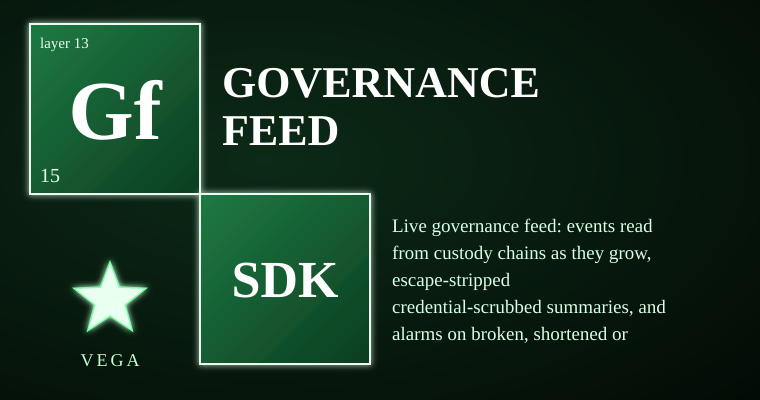

# vega-governance-feed-sdk

Live governance feed: events read from custody chains as they grow, escape-stripped credential-scrubbed summaries, and critical alarms on broken, shortened, or rewritten chains. It owns the watch concern — giving a human operator a tamper-evident view of what the governed system is doing — so that a chain cut, edited, or replaced cannot pass silently. The failure it prevents is invisible tamper: an attacker who edits history, truncates the chain, or swaps replicas is detected on the next poll and raised as a critical alarm that persists until the chain is repaired.

> **Licensing.** Source-available, not open source. Free for personal use; free for registered small businesses (under US$1M revenue and valuation); everyone else needs a commercial license (see LICENSE; for a commercial license write to jasonblasiak.ai.mail@gmail.com). Patent pending. Draft licence text, not yet reviewed by an attorney.

## Specifications

| Item | Value |
|---|---|
| Package | `vega_feed` (src layout) |
| Version | 0.1.0 |
| Python | >=3.10 |
| Dependencies | `vega-custody-sdk` |
| Tests | 36 tests in 4 files, all passing (per REVIEW.md) |
| Status | BUILT: feed, display (per STATUS.md) |

## End-to-end functions

1. **Configure sources** — Provide a dict mapping source names to lists of replica file paths (custody chain JSONL files).
2. **Initialize Feed** — `Feed(sources, state_path)` validates names, paths, and loads prior cursor if a state file exists.
3. **Subscribe (optional)** — Register callbacks with `feed.subscribe(fn)` for push delivery; crashes in one subscriber do not stop others.
4. **Poll** — Call `feed.poll()` to get new events since last cursor plus any critical alarms. Each poll:
   - Verifies each chain via `vega_custody.dag.Chain` (hash chain integrity, replica agreement).
   - Detects `CHAIN_BROKEN` (hash mismatch, unreadable, replica disagreement), `CHAIN_SHORTENED` (chain shorter than cursor), `CHAIN_REWRITTEN` (historical entry replaced).
   - Raises each distinct alarm once per problem (signature-deduplicated); cursor does not advance while a source is in alarm.
   - For new entries: builds summaries from an allow-list of payload fields, strips terminal escape sequences, scrubs credential-shaped values to `[REDACTED]`, clips to 200 chars.
   - Updates cursor and persists to `state_path` atomically.
5. **Snapshot** — `feed.snapshot()` returns counters by severity/kind and per-source cursors for status panels.

## Controls

| Control | What it does |
|---|---|
| `Feed(sources, state_path)` | Constructor. `sources`: dict[name] = list[path]. `state_path`: optional JSON file for cursor persistence. |
| `feed.subscribe(fn)` | Register a callable `fn(event_dict)`; called for each event/alarm after `poll()` returns. |
| `feed.poll()` | Main entry point. Returns list of event dicts. Thread-safe. |
| `feed.snapshot()` | Read-only status: `{"cursor": {...}, "counters": {...}, "alarmed": [...]}` |
| `severity(kind)` | Module function: maps event kind to `"critical"`, `"alert"`, or `"info"`. |
| `summarize(entry)` | Module function: builds safe summary dict from allow-listed payload fields. |
| `plain(text)` | From `vega_feed.display`: strips ANSI escapes and control characters. |
| `FeedRefused` | Exception raised on invalid constructor args or bad subscriber. |
| `MAX_SOURCES = 64` | Hard limit on number of named sources per Feed instance. |
| `SHOW` tuple | Allow-list of payload field names that may appear in summaries. |
| `ALERT_WORDS` tuple | Keywords that elevate severity to `"alert"` when present in event kind. |

## What it CANNOT do

- It reads; it never writes to a chain and never decides or authorizes anything.
- A chain cut off entirely and replaced before the feed's first poll cannot be noticed: the feed needs its own earlier cursor, kept elsewhere.
- It does not authenticate the human operator; it assumes the custody chain itself is the source of truth.
- It does not encrypt the state file; cursor persistence is integrity-protected by the chain, not by the state file.
- Not production-hardened; not independently security-reviewed; crypto not expert-reviewed.
- No native mobile build; runs inside a Python runtime (Termux on Android, BeeWare/Kivy on Apple) where dependencies are supported.
- No GPU/TPM/hardware key dependency.

## Platform support

| Platform | Support |
|---|---|
| Windows (CPython 3.10+) | Full — pure Python, no POSIX-only code |
| macOS (CPython 3.10+) | Full |
| Linux (CPython 3.10+) | Full |
| Android | Via Termux Python runtime only; no native .apk |
| iOS / iPadOS | Via BeeWare/Kivy Python runtime only; no native .ipa |
| GPU / TPM / hardware keys | Not required; no hardware-dependent code |

## Standalone & unified install

**Standalone:** `pip install -e .` installs with one declared dependency (`vega-custody-sdk`). It imports nothing from other family SDKs — installs and runs alone with zero family dependencies beyond the custody layer.

**Unified:** Registered in `vega-umbrella-sdk` registry as layer 13 (watch), depending on `custody` only. The umbrella resolves wiring; this SDK does not import harness, reasoning, metacog, or any upper-layer SDK.

## Diagnostic control

- **CLI:** None published (no `console_scripts` in pyproject.toml).
- **Programmatic introspection:** `feed.snapshot()` returns cursors, counters, alarmed sources.
- **Log surface:** Uses stdlib `logging` via `vega_custody` internals; no dedicated logger in this SDK.
- **Exit codes / fail-closed indicators:** `FeedRefused` on construction/config errors; `poll()` returns alarms with `"severity": "critical"` and `entry_hash: null`; cursor does not advance while alarmed.
- **Environment variables:** None honored directly.

## Fail-closed constraints & custom constraints

**Fail-closed points (enforced in `feed.py`):**
- Constructor refuses empty sources, invalid names, non-list paths, >64 sources (`FeedRefused`).
- `poll()` verifies chain integrity via `Chain(paths)` — on `ChainBroken` or unreadable: raises `CHAIN_BROKEN` alarm, cursor frozen.
- `poll()` detects `len(rows) < cursor[len]` → `CHAIN_SHORTENED`, cursor frozen.
- `poll()` detects historical entry hash mismatch → `CHAIN_REWRITTEN`, cursor frozen.
- Alarm deduplication by SHA256(kind+detail); same problem not re-announced until cleared.
- Alarm clears only when chain verifies and cursor can advance (`self._alarmed.pop(name, None)`).
- Subscriber exceptions caught and swallowed; feed continues.
- State file corruption/absence → starts from beginning (safe direction: re-reports events).

**Custom constraints:** This version publishes no user-defined constraint hooks; constraints are fixed by the module and the jurisdiction floor (vega-jurisdiction-sdk). The allow-list `SHOW`, `ALERT_WORDS`, `MAX_SOURCES` are module constants — not configurable at runtime.

---

One family, one organism: every SDK owns exactly one concern and uses the owner of every other concern instead of growing its own copy.
